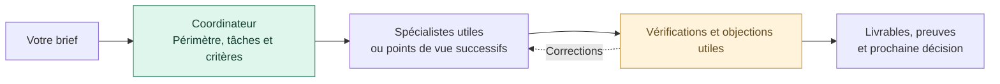

<p align="center">
  
</p>

<p align="center">
  <strong>Transformez votre brief en travail coordonné par une équipe IA.</strong><br>
  Étudiez une idée, préparez un lancement, développez un produit ou améliorez votre activité.
</p>

<p align="center">
  <a href="README.md">English</a> ·
  <a href="#installation">Installer</a> ·
  <a href="#votre-première-mission">Commencer</a> ·
  <a href="evals/pilote-2026-10-22/README.md">Résultats d’évaluation</a> ·
  <a href="#documentation-et-développement">Guides</a>
</p>

## Qu’est-ce qu’Orka ?

**Orka est un Agent Skill qui apprend à votre assistant à coordonner des spécialistes autour d’une mission.** Vous décrivez le résultat attendu. Un coordinateur sélectionne les rôles utiles, organise leur travail et les revues, puis restitue les conclusions, les preuves et les questions ouvertes.

Le skill est un dossier d’instructions, de références et d’outils facultatifs. Votre assistant fournit les modèles, l’accès aux fichiers, la recherche et les éventuels sous-agents. Si leur utilisation est autorisée, Orka délègue à des spécialistes distincts ; sinon, il applique leurs points de vue successivement et le précise.

**28 rôles · 8 équipes · 9 workflows.** Seuls les rôles utiles à la mission sont mobilisés.

## À quoi sert-il ?

| Mission | Résultat à demander |
|---|---|
| Explorer une idée | Une synthèse sourcée, les incertitudes et le prochain test de validation |
| Préparer un lancement | Le positionnement, un plan marketing et des contenus préparés |
| Développer un produit | Une réalisation dans votre dépôt, ses tests et les remarques de revue |
| Améliorer l’activité | Des actions prioritaires à partir des retours clients, des opérations ou de l’usage des agents |

## Comment se déroule une mission ?



Une petite tâche garde un traitement compact. L’accord des agents ne prouve pas la demande du marché ; les critères non vérifiés restent visibles.

## Installation

**Vous pouvez installer et utiliser Orka sans Python.**

1. Téléchargez [orka.zip](https://github.com/AjinthAT/orka-skill/releases/latest/download/orka.zip) et décompressez-le. Utilisez le ZIP du skill, pas l’archive du dépôt complet.
2. Copiez tout le dossier `orka`, avec ses références et guides, dans le dossier de skills de votre assistant :

   | Assistant | Dossier utilisateur par défaut | Invocation |
   |---|---|---|
   | Codex | `~/.agents/skills/orka/` | `$orka` |
   | Claude Code | `~/.claude/skills/orka/` | `/orka` |
   | Hermes, profil par défaut | `~/.hermes/skills/orka/` | `/orka` |

3. Ouvrez une nouvelle session si nécessaire, sélectionnez Orka et donnez-lui une mission.

Adaptez le chemin à votre configuration et sauvegardez une installation existante avant remplacement. Pour **Claude Web/ordinateur**, importez le ZIP dans l’interface des skills personnalisés ; sa disponibilité dépend de votre compte et de votre organisation.

[Guide d’installation détaillé →](docs/INSTALLATION.fr.md) — installateur Python facultatif, installation par projet, autres assistants, mise à jour et désinstallation.

## Votre première mission

Utilisez **`$orka` dans Codex** ou **`/orka` dans Claude Code ou Hermes**, puis donnez un brief concret. Par exemple :

```text
Étudie un outil de réservation pour les coachs sportifs indépendants en France.
Examine les concurrents, les besoins, la faisabilité technique et les hypothèses
économiques. Utilise des sous-agents si disponibles et autorisés. Conserve une
synthèse avec sources, incertitudes et prochain test de validation.
```

Précisez le projet, le résultat attendu, les fichiers utiles et les contraintes connues. Vous pouvez passer directement au marketing, au développement ou au support si c’est votre besoin.

Le [guide de démarrage](.agents/skills/orka/GUIDE.fr.md), inclus dans chaque ZIP du skill, propose d’autres prompts. Orka termine ses réponses par un **« Prochain prompt à copier »**, sauf préférence contraire ou format exclusif demandé. Cette suggestion ne s’exécute pas automatiquement.

## Quand faut-il Python ?

| Usage | Prérequis |
|---|---|
| Installation manuelle et usage courant du skill | Aucune exigence Python d’Orka |
| Installateur fourni ou outils locaux | Python 3.10+, bibliothèque standard uniquement |
| Vérifications du dépôt | Python et dépendances de développement |

Commencez avec les documents de mission. Le préparateur facultatif rend les mandats répétables ; le registre conserve les réservations, tentatives et versions d’entrées après interruption ; le bilan synthétise des mesures fournies. Utilisez-les quand leurs contrôles servent votre mission.

Le [diagnostic d’installation facultatif](.agents/skills/orka/references/diagnostic-installation.md) examine un dossier explicite en lecture seule, avec comparaison optionnelle à une référence. La procédure manuelle sans Python reste disponible ; la présence des fichiers ne prouve pas l’activation par l’hôte.

Ces outils ne lancent pas les modèles, ne collectent pas les tokens et n’imposent pas de plafond financier. L’usage des modèles dépend de l’offre de votre assistant. Les exigences techniques de votre propre projet restent distinctes.

## Compatibilité et limites

- Orka suit le [format Agent Skills](https://agentskills.io/specification). Modèles, outils et délégation dépendent de l’assistant ; tous les hôtes n’ont pas été évalués sur une mission complète.
- Les instructions détaillées sont actuellement en français. Les guides existent en anglais et français ; les livrables suivent la langue demandée.
- Le catalogue de modèles et le préparateur fournis ciblent les paramètres Codex. Sur un autre hôte, utilisez les réglages natifs et le suivi documentaire, sauf catalogue compatible configuré.
- Orka travaille pendant les sessions autorisées. L’installation ne crée pas de service permanent. Communications externes, dépenses, publication et déploiement nécessitent une autorisation couvrant l’action.

## Résultats d’évaluation

[Consulter le premier pilote →](evals/pilote-2026-10-22/README.md) — trois cas synthétiques comparant chacun un assistant seul, Orka sans délégation et Orka avec deux spécialistes.

Les neuf livrables satisfont les critères examinés. **Aucun avantage de qualité ou de coût n’est établi.** Un spécialiste a lu Orka hors de la copie figée, ce qui limite la comparabilité de cette cellule. L’index donne accès aux livrables, vérifications, traces et prompts originaux. Ce pilote évalue Orka 0.4.0 dans Codex, avec un essai par cellule ; tokens et coûts sont indisponibles.

## Documentation et développement

Le [suivi ECC-01](docs/LOT-ECC-01.md) distingue L1, diagnostic livré en 0.5.0, du contexte progressif et des outils d’évaluations répétées encore prévus. Les critères d’acceptation et leurs preuves restent séparés des campagnes à venir.

| Pour commencer | Pour approfondir |
|---|---|
| [Guide de démarrage](.agents/skills/orka/GUIDE.fr.md) · [English](.agents/skills/orka/GUIDE.md) | Premières missions, prompts et reprise |
| [Installation](docs/INSTALLATION.fr.md) | Copie manuelle, installateur facultatif et détails par assistant |
| [Équipes et rôles](.agents/skills/orka/references/roles.md) | Stratégie, marketing, vente, produit, technique, finance, ressources IA et relation client |
| [Workflows](.agents/skills/orka/references/workflows-entreprise.md) | Étude, réalisation, lancement et transmissions entre services |
| [Entrée du skill](.agents/skills/orka/SKILL.md) | Coordination et références : vision, innovation, expériences, noms et ressources des agents |
| [Implémentation](docs/IMPLEMENTATION.md) | Supervision locale, capacités disponibles et évolutions |
| [Évaluations](evals/README.md) | Cas, résultats conservés et limites de méthode |

Conservez les données privées de mission hors de ce dépôt public. Les missions produit utilisent `projets/<id>/` ; les missions transversales, `entreprise/missions/<id>/`. Le code applicatif reste dans son dépôt désigné.

Pour vérifier le dépôt depuis sa racine :

```sh
python3 -m pip install -r requirements-dev.txt
python3 -B tools/verifier.py
```

Le vérificateur contrôle métadonnées, liens locaux, tests après déplacement et contenu du ZIP. GitHub Actions l’exécute sur Linux, macOS et Windows avec Python 3.10 et 3.13. Pour contribuer par issue ou pull request, décrivez le problème observé et les vérifications utiles.

Licence [MIT](LICENSE), incluse dans le ZIP et les installations.
