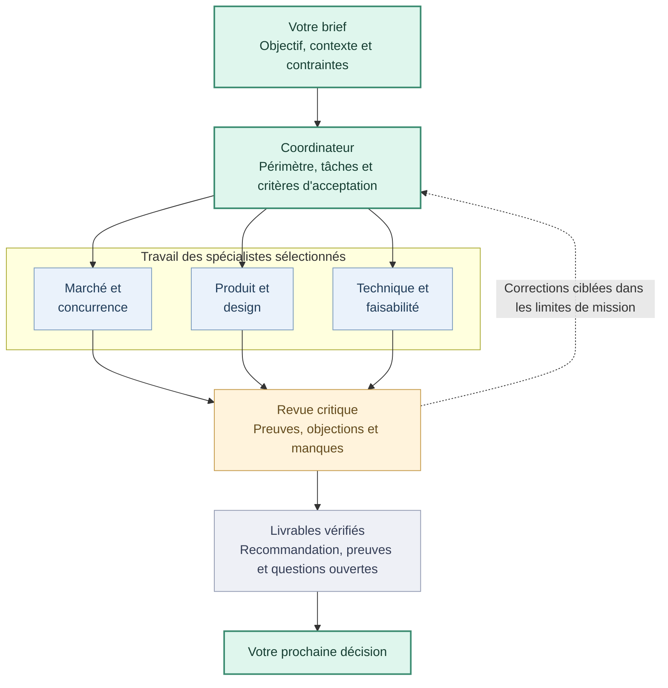
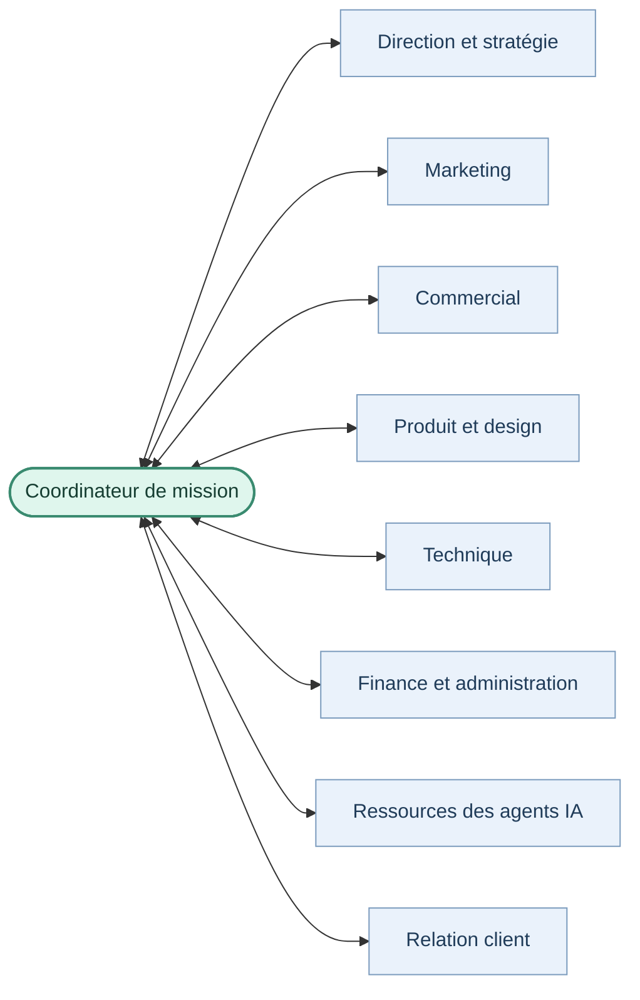
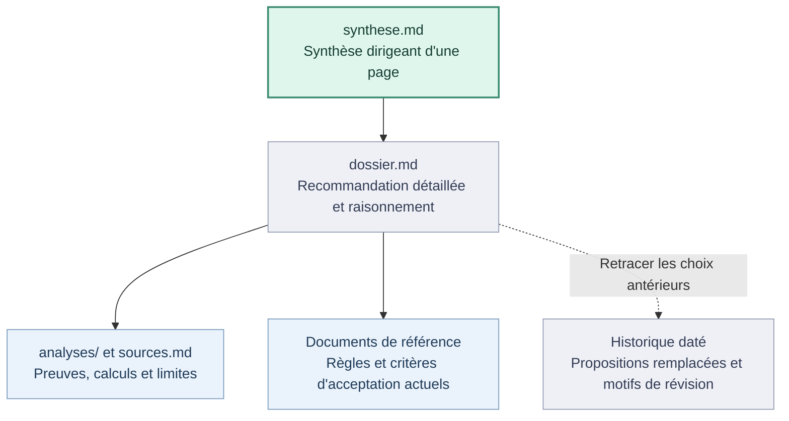

<p align="center">
  
</p>

<p align="center">
  <strong>Une équipe d'entreprise coordonnée dans votre assistant IA.</strong><br>
  Étudier une idée, préparer un lancement, coordonner un développement ou améliorer une activité.
</p>

<p align="center">
  <a href="README.md">English</a> ·
  <a href="#presentation">Présentation</a> ·
  <a href="#installation">Installation</a> ·
  <a href="https://github.com/AjinthAT/orka-skill/releases/latest/download/orka.zip">Télécharger</a> ·
  <a href="#documentation-et-développement">Documentation</a>
</p>

---

<a id="presentation"></a>

## Qu'est-ce qu'Orka ?

**Orka apprend à votre assistant IA à coordonner une équipe de spécialistes autour d'une mission commune.**

Vous décrivez votre projet et le résultat attendu. Un coordinateur choisit les rôles utiles, définit leurs tâches, organise les échanges et les objections, puis rassemble leurs travaux dans des livrables vérifiés.

Un **Agent Skill** est un dossier d'instructions réutilisables, de références et d'outils qu'un assistant peut charger au besoin. Orka s'utilise dans votre assistant habituel : l'application fournit les modèles, l'accès aux fichiers, les outils de recherche et les éventuels sous-agents. Le skill apporte la méthode de travail.

Si les sous-agents sont disponibles et autorisés, le coordinateur peut déléguer. Sinon, il applique successivement les points de vue et le signale. Une petite tâche mobilise une petite équipe.

## À quoi sert Orka ?

| Votre mission | Le travail organisé | Exemples de livrables |
|---|---|---|
| **Explorer une idée** | Marché, concurrence, produit, faisabilité et hypothèses économiques | Dossier de décision sourcé, inconnues, protocole de validation |
| **Préparer un lancement** | Positionnement, canaux, approche commerciale et contenus | Plan marketing, brouillons, supports de prospection |
| **Développer un produit** | Périmètre, conception, développement, tests et revue | Réalisation dans le dépôt désigné, résultats de tests, constats de revue |
| **Améliorer l'activité** | Retours clients, priorités, finance, ressources IA et exploitation | Actions priorisées, hypothèses budgétaires, allocations des agents ou documents support |

Commencez par la mission dont vous avez besoin. Une demande marketing n'impose pas une nouvelle étude de marché ; un développement approuvé peut passer directement à la réalisation.

## Comment se déroule une mission ?



*Exemple d'étude : le coordinateur choisit seulement les rôles utiles. Le travail peut avancer en parallèle si les outils, dépendances et autorisations le permettent. Les critères non résolus restent explicites dans une remise partielle.*

1. **Cadrer :** préciser le périmètre, les entrées, les contraintes et les critères d'acceptation.
2. **Répartir :** choisir les spécialistes, identifier les dépendances et attribuer une sortie distincte par tâche.
3. **Produire et confronter :** exécuter les travaux prêts, partager les constats et examiner les objections utiles.
4. **Vérifier et livrer :** contrôler les preuves, consolider les résultats et conserver décisions, incertitudes et suites.

Une étude peut recommander de tester, modifier ou arrêter le projet. L'accord des agents ne prouve pas l'existence d'une demande client.

## Découvrez l'équipe

**28 rôles répartis en 8 équipes**, disponibles selon la mission. Ce catalogue n'impose pas 28 agents simultanés.



*Le coordinateur cadre les tâches, recueille les résultats et relaie les questions utiles entre services. Les flèches représentent des relations de travail, pas huit équipes actives en permanence.*

<details>
<summary><strong>Voir les spécialités de chaque équipe</strong></summary>

| Équipe | Spécialités |
|---|---|
| **Direction et stratégie** | Coordination, étude de marché, concurrence, évaluation critique |
| **Marketing** | Stratégie, rédaction, SEO, réseaux sociaux, acquisition |
| **Commercial** | Vente, prospection, partenariats |
| **Produit et design** | Priorités, gestion de projet, UX/UI |
| **Technique** | CTO, architecture, frontend, backend, sécurité, QA, DevOps |
| **Finance et administration** | Budget, économie du projet, suivi administratif |
| **Ressources des agents IA** | Modèles, effort de raisonnement, tokens et qualification des agents |
| **Relation client** | Support, adoption, fidélisation |

</details>

Les [neuf workflows](.agents/skills/orka/references/workflows-entreprise.md) couvrent étude, marketing, commercial, réalisation, lancement, relation client, finance, ressources des agents IA et pilotage. [Consulter les rôles →](.agents/skills/orka/references/roles.md)

## Que contient le projet ?

| Élément | Utilité |
|---|---|
| **Instructions de coordination** | Cadrage, délégation, échanges, revue et transmission |
| **Rôles et workflows** | Mobiliser les compétences adaptées à la mission |
| **Modèles de documents partagés** | Ouvrir une étude par une synthèse d'une page ; retrouver preuves, règles actuelles et historique |
| **Outils locaux facultatifs** | Préparer les mandats et suivre dépendances, réservations, tentatives et acceptation |

Les outils utilisent Python et SQLite, sans paquet Python tiers. Ils préparent et enregistrent le travail ; l'assistant fournit l'exécution des modèles. L'installation ne lance aucun agent, ne crée aucun service et ne nécessite aucune clé API. L'utilisation des modèles dépend de votre assistant, de votre abonnement et des coûts associés.

## Renforcer le projet avant de l'élargir

Orka propose des guides ciblés pour approfondir les points utiles à la mission :

| Besoin | Méthode |
|---|---|
| **Clarifier la vision** | Poser les questions qui changent la décision ; préserver l'ambition et la distinguer du premier test |
| **Vérifier plutôt que supposer** | Qualifier les affirmations décisives, chercher les preuves accessibles et montrer inconnues ou contradictions |
| **Innover utilement** | Comparer des pistes distinctes sur la valeur, la différence, l'adoption, la faisabilité et un test minimal |
| **Apprendre par l'expérience** | Relier chaque hypothèse critique à un test borné, des preuves observées et une décision ; garder les résultats inconclusifs et pistes abandonnées |
| **Éprouver faisabilité et adoption** | Isoler le verrou technique, puis examiner l'effort et la valeur pour les personnes qui utilisent le produit |
| **Trouver un nom court et international** | Examiner sens, prononciation et confusion dans les langues visées ; vérifier les domaines finalistes avec des sources datées |
| **Allouer efficacement les agents** | Adapter modèle, effort et contexte à la tâche ; relever l'usage réel accessible et qualifier les ajustements sur les résultats |

Ces guides s'appliquent avec les outils de l'assistant. La disponibilité d'un domaine exige une vérification actuelle ; le comptage des tokens exige des mesures. Le [bilan local des agents](.agents/skills/orka/references/bilan-agents.md) résume les tentatives, revues, tokens connus et coûts fournis, avec leur couverture. Il ne collecte pas de mesures et n'applique pas de plafond financier. Les outils locaux ne fournissent ni connexion à un registrar ni compteur de tokens.

Le [guide des expériences](.agents/skills/orka/references/experiences-apprentissage.md) distingue test proposé et test exécuté, faisabilité technique et adoption réelle. Il conserve aussi les motifs d'abandon d'une piste et les conclusions à réexaminer lorsqu'une preuve change.

## Ce que vous recevez après une étude

Commencez par la synthèse de décision, puis ouvrez les liens vers les détails utiles.



*Structure d'étude illustrative. Les documents sont créés seulement s'ils sont utiles ; une mission compacte peut réunir synthèse, résultat et vérifications dans un seul fichier. Les recommandations restent distinctes de votre autorisation d'agir.*

## Votre première mission

Chaque installation et archive contient le [guide de démarrage français](.agents/skills/orka/GUIDE.fr.md) et sa [version anglaise](.agents/skills/orka/GUIDE.md), avec des prompts pour cadrer une idée, étudier, préparer le marketing, développer et reprendre un dossier. Vous pouvez demander à Orka de présenter ce guide à tout moment.

Après installation, utilisez **`$orka` dans Codex** ou **`/orka` dans Claude Code**, puis donnez une mission concrète :

> Étudie un outil de prise de rendez-vous pour les coachs sportifs indépendants en France. Examine les concurrents, les besoins, la faisabilité technique et les hypothèses de prix. Utilise des sous-agents spécialisés si les outils et les autorisations le permettent, examine leurs objections et produis un dossier de décision avec sources, incertitudes et prochain test de validation.

Autres points de départ :

- **Marketing :** « Prépare le positionnement, le plan de lancement et les brouillons de contenus pour ce produit. »
- **Développement :** « Coordonne la réalisation de cette fonctionnalité approuvée dans ce dépôt, avec des sorties distinctes pour le développement et la revue. »
- **Support :** « Analyse ces retours et propose un plan d'amélioration priorisé. »

Précisez le projet, le résultat attendu, les fichiers utiles et les contraintes connues. Orka doit distinguer faits sourcés, hypothèses, recommandations et décisions humaines. Contacter des tiers, dépenser, publier ou déployer nécessite une autorisation couvrant l'action.

Chaque réponse Orka se termine par **« Prochain prompt à copier »** : une seule suite concrète adaptée à l'état du projet. Copiez-la, modifiez-la ou demandez une réponse sans suggestion. Orka termine d'abord le travail autorisé ; la proposition ne lance pas automatiquement l'étape suivante.

## Choisir votre assistant

Orka suit le [format ouvert Agent Skills](https://agentskills.io/specification).

| Application | Installation | Invocation |
|---|---|---|
| **Codex** | Installateur fourni | `$orka` |
| **Claude Code** | Installateur fourni | `/orka` |
| **Claude Web / ordinateur** | Importer le ZIP du skill | Demander d'utiliser Orka |
| **Hermes Agent** | Copier dans son dossier de skills avec `--destination` | `/orka` |
| **Autres applications Agent Skills** | Utiliser leur dossier de skills documenté | Selon l'application |

Ces méthodes d'installation ne garantissent pas une exécution identique. Modèles, délégation, recherche et fichiers dépendent de l'application. L'installation locale et l'archive sont testées ; une mission complète avec des modèles n'a pas été évaluée sur chaque plateforme.

## Installation

### Codex ou Claude Code

Téléchargez et décompressez le [code source](https://github.com/AjinthAT/orka-skill/archive/refs/heads/main.zip), ou clonez le dépôt :

```sh
git clone https://github.com/AjinthAT/orka-skill.git
cd orka-skill
```

Avec Python 3.10 ou plus récent, choisissez la commande correspondant à votre assistant :

```sh
# Codex : installation pour votre utilisateur
python3 install.py --agent codex

# Claude Code : installation pour votre utilisateur
python3 install.py --agent claude
```

Sous Windows, utilisez `py -3` si `python3` n'est pas disponible. Aucun paquet Python tiers n'est nécessaire.

| Assistant | Pour votre utilisateur | Pour un projet |
|---|---|---|
| Codex | `~/.agents/skills/orka/` | `<projet>/.agents/skills/orka/` |
| Claude Code | `~/.claude/skills/orka/` | `<projet>/.claude/skills/orka/` |

Pour limiter l'installation à un projet existant, ajoutez `--project /chemin/du/projet`. Sans cette option, l'installation concerne votre utilisateur.

L'installateur copie le dossier complet, la licence et les deux guides de démarrage, puis affiche leurs chemins et un premier message suggéré. Il fonctionne sans appel réseau ni modification de vos paramètres et refuse d'écraser un dossier existant. Ouvrez une nouvelle session si nécessaire, puis utilisez `$orka` dans Codex ou `/orka` dans Claude Code. Les imports ZIP contiennent aussi les guides ; leur ouverture automatique dépend de l'application.

### Claude sur le Web ou sur ordinateur

Téléchargez [orka.zip](https://github.com/AjinthAT/orka-skill/releases/latest/download/orka.zip), puis importez cette archive dans l'interface des skills personnalisés de Claude et activez-la. Utilisez l'archive du skill, et non celle du dépôt complet. La disponibilité dépend de votre compte et des paramètres de votre organisation : consultez le [guide officiel Claude](https://support.claude.com/en/articles/12512180-use-skills-in-claude).

L'import ne donne pas accès à vos fichiers locaux et n'active pas de sous-agents parallèles. Les outils et le stockage restent ceux de l'application hôte.

### Hermes Agent

Depuis le dépôt cloné, installez Orka dans le profil Hermes par défaut :

```sh
python3 install.py --destination "$HOME/.hermes/skills/orka"
```

Ouvrez une nouvelle session, puis utilisez `/orka`. Pour un autre profil ou `HERMES_HOME`, indiquez son dossier `skills/orka` avec `--destination`. Ce chemin suit la [documentation Hermes](https://hermes-agent.nousresearch.com/docs/user-guide/features/skills) ; une mission Orka complète dans Hermes n'a pas encore été testée.

### Autres assistants

Le dossier suit le [format ouvert Agent Skills](https://agentskills.io/specification). Copiez l'intégralité de `.agents/skills/orka/` dans le répertoire documenté par votre application, ou indiquez une destination exacte :

```sh
python3 install.py --destination /chemin/des/skills/orka
```

Un modèle seul ne suffit pas : l'application qui l'utilise doit prendre en charge les skills ou pouvoir lire ces fichiers et leurs références. Sans prise en charge native, vous pouvez fournir les fichiers manuellement ; leur découverte automatique n'est pas disponible. La compatibilité avec toutes les applications IA n'est pas garantie.

## Compatibilité et limites actuelles

- Les instructions, rôles, workflows et modèles de documents sont partageables entre applications. Les références détaillées sont en français ; les livrables suivent la langue demandée.
- Les modèles disponibles, leurs réglages, la recherche, la délégation et l'accès aux fichiers dépendent de chaque assistant. Le catalogue fourni et le préparateur JSON ciblent les paramètres Codex : ils ne configurent pas Claude.
- Le préparateur de mandats et le registre SQLite sont facultatifs. Le registre appelle le préparateur et partage ses contraintes de catalogue. Sur un autre hôte sans catalogue compatible, utilisez les mandats et le suivi documentaire avec les réglages natifs.
- Aucun de ces outils ne lance de modèle, n'arrête d'agent ou ne fonctionne en permanence. Les tests locaux vérifient les outils, l'installation et l'archive ; chaque plateforme n'a pas fait l'objet d'une évaluation complète avec des modèles réels.

## Documentation et développement

Le [README anglais](README.md#documentation) présente l'index complet. Guides ciblés : [ressources IA](.agents/skills/orka/references/ressources-agents.md), [vision et innovation](.agents/skills/orka/references/vision-preuves-innovation.md), [expériences et apprentissages](.agents/skills/orka/references/experiences-apprentissage.md), [bilan des agents](.agents/skills/orka/references/bilan-agents.md), [noms et domaines](.agents/skills/orka/references/noms-domaines.md). Points d'entrée : [rôles](.agents/skills/orka/references/roles.md), [workflows](.agents/skills/orka/references/workflows-entreprise.md), [orchestration](.agents/skills/orka/references/orchestration-agents.md), [supervision locale](.agents/skills/orka/references/supervision-locale.md), [modèles](.agents/skills/orka/references/modeles-effort.md) et [implémentation](docs/IMPLEMENTATION.md).

Les dossiers de mission produit utilisent `projets/<id>/` ; les missions transversales utilisent `entreprise/missions/<id>/`. Le code applicatif reste dans son dépôt de développement. Conservez les données privées de mission hors de ce dépôt de distribution public. Les exemples du registre utilisent le dossier local ignoré `.orka/`.

```sh
python3 -B .agents/skills/orka/scripts/test_preparer_agent.py
python3 -B .agents/skills/orka/scripts/test_superviser.py
python3 -B .agents/skills/orka/scripts/test_bilan_agents.py
python3 -B -m unittest discover -s tests
python3 install.py --archive dist/orka.zip
```

Pour mettre à jour : examinez les changements, sauvegardez vos adaptations, supprimez l'ancien dossier installé `orka`, puis relancez l'installation. Pour désinstaller, supprimez uniquement ce dossier ; les livrables de mission restent en place. Les contributions peuvent passer par les issues et pull requests, avec le problème observé et les vérifications pertinentes.

Licence [MIT](LICENSE), incluse dans les installations et l'archive. Références de format et d'installation : [OpenAI](https://learn.chatgpt.com/docs/build-skills), [Claude Code](https://code.claude.com/docs/en/skills). L'organisation et les workflows d'Orka sont les choix de ce projet.
