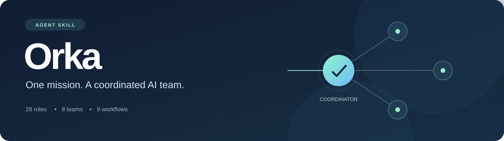
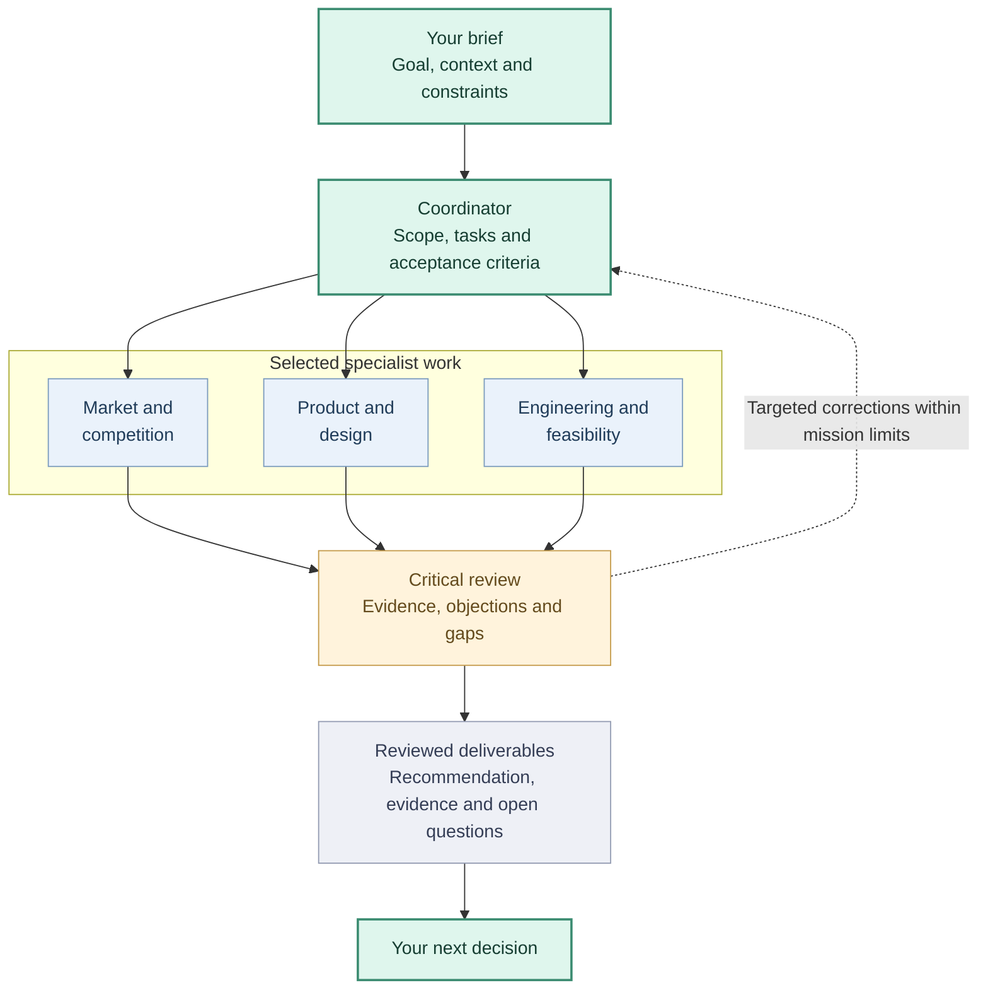
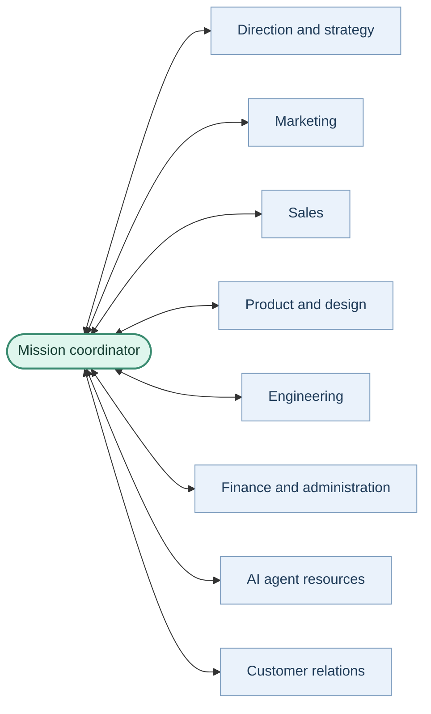
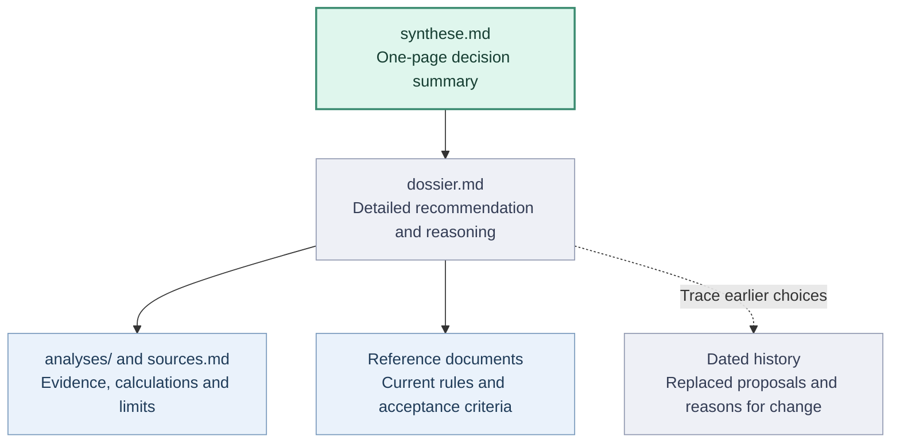

<p align="center">
  
</p>

<p align="center">
  <strong>A business-team skill for your AI assistant.</strong><br>
  Research an idea, plan a launch, coordinate delivery, or improve an existing business.
</p>

<p align="center">
  <a href="README.fr.md">Français</a> ·
  <a href="#what-is-orka">Overview</a> ·
  <a href="#installation">Installation</a> ·
  <a href="https://github.com/AjinthAT/orka-skill/releases/latest/download/orka.zip">Download</a> ·
  <a href="#documentation">Documentation</a>
</p>

---

## What is Orka?

**Orka teaches your AI assistant how to coordinate a team of business specialists around a shared mission.**

You describe the project and the result you need. A coordinator selects the relevant roles, defines their tasks, organizes useful exchanges and objections, and brings their work together into checked deliverables.

An **Agent Skill** is a folder of reusable instructions, references and tools that an assistant can load when needed. Orka runs inside your existing assistant: the host provides the models, file access, research tools and any subagents. The skill provides the working method.

With authorized subagents, the coordinator can delegate to separate specialists. Otherwise, it applies their perspectives sequentially and makes that clear. A small task uses a small team.

## What can you use it for?

| Your mission | The work Orka helps organize | Example deliverables |
|---|---|---|
| **Explore an idea** | Market, competition, product, technical feasibility and business assumptions | Sourced decision brief, open questions, validation plan |
| **Prepare a launch** | Positioning, channels, sales approach and content | Marketing plan, draft copy, prospecting materials |
| **Build a product** | Scope, design, engineering, testing and review | Implementation in the designated repository, test results, review findings |
| **Improve the business** | Customer feedback, priorities, finance, agent resources and operations | Prioritized actions, budget assumptions, agent allocation or support documents |

Start with the mission you actually need. A marketing request does not require a new market study; an approved development task can go straight to delivery.

## How a mission works



*Example of a study: the coordinator selects only the roles needed. Work can run in parallel when tools, dependencies and permissions allow it. Unresolved criteria remain explicit in a partial delivery.*

1. **Frame:** establish scope, inputs, constraints and acceptance criteria.
2. **Assign:** select specialists, identify dependencies and give each task a distinct output.
3. **Work and challenge:** execute ready tasks, share findings and examine objections that could change the result.
4. **Verify and deliver:** check the evidence, consolidate reviewed outputs and record decisions, uncertainty and next steps.

An idea study may end with a recommendation to test, change or stop the project. Agreement between agents is not proof of customer demand.

## Meet the team

**28 roles across 8 teams**, available as a catalogue rather than 28 agents that must all run at once.



*The coordinator frames assignments, collects results and relays useful questions between teams. Arrows describe working relationships, not eight teams running permanently.*

<details>
<summary><strong>Explore the specialties in each team</strong></summary>

| Team | Specialties |
|---|---|
| **Direction & strategy** | Coordination, market research, competition, critical review |
| **Marketing** | Strategy, copywriting, SEO, social media, acquisition |
| **Sales** | Sales planning, prospecting, partnerships |
| **Product & design** | Product priorities, project management, UX/UI |
| **Engineering** | CTO, architecture, frontend, backend, security, QA, DevOps |
| **Finance & administration** | Budgets, economics, administrative tracking |
| **AI agent resources** | Models, reasoning effort, token usage and agent qualification |
| **Customer relations** | Support, adoption, retention |

</details>

The [nine workflows](.agents/skills/orka/references/workflows-entreprise.md) cover studies, marketing, sales, delivery, launch, customer relations, finance, AI agent resources and business steering. [Explore the roles →](.agents/skills/orka/references/roles.md)

## What is included?

| Component | Purpose |
|---|---|
| **Coordination instructions** | Guide scoping, delegation, collaboration, review and handoffs |
| **Roles and workflows** | Bring in the right specialist perspectives for each mission |
| **Shared document templates** | Open a study with a one-page decision summary; keep evidence, current rules and history easy to find |
| **Optional local tools** | Prepare task requests; track input versions, direct and indirect dependencies, reservations, attempts and artifact acceptance |

The local tools use Python and SQLite, with no third-party Python packages. They prepare and record work; model execution comes from the assistant. Installation itself does not start agents, provision services or require an API key. Model usage remains subject to your assistant's plan and costs.

The register now supports explicit re-examination of completed work and a backed-up migration from schema v1. Historical input versions that were never recorded remain unknown; see [local supervision](.agents/skills/orka/references/supervision-locale.md) before opening an older register with this version.

## Sharpen the project before expanding it

Orka includes optional guides for the parts of a project that need more than another feature list:

| Need | Working method |
|---|---|
| **A clearer vision** | Ask the questions that change the decision; preserve the original ambition and distinguish it from the first experiment |
| **Evidence instead of assumptions** | Track decisive claims, verify accessible facts, and keep unknowns or contradictions visible |
| **Useful innovation** | Compare distinct approaches on value, differentiation, adoption, feasibility and a minimal test |
| **Learning through experiments** | Link each critical hypothesis to a bounded test, observed evidence and a decision; keep inconclusive results and abandoned approaches visible |
| **Feasibility and adoption** | Test the smallest technical uncertainty, then examine the effort and value for people using the product |
| **A short international name** | Evaluate meaning, pronunciation and confusion in the target languages; check shortlisted domains with dated sources |
| **An efficient AI team** | Match model, effort and context to each task; record real usage when available and qualify changes against results |

These are procedures applied with the host's available tools. Domain availability needs a live check; token accounting needs actual telemetry. The optional [agent report](.agents/skills/orka/references/bilan-agents.md) summarizes supplied attempts, reviews, known tokens and costs, with explicit coverage. It does not collect telemetry or enforce a budget. The local helpers do not provide a registrar integration or a token meter.

The [experiment guide](.agents/skills/orka/references/experiences-apprentissage.md) separates a proposed test from an executed one, and technical feasibility from real adoption. It also preserves the reasons for abandoning an approach and identifies conclusions to revisit when evidence changes.

## What a study delivers

Start with the short decision summary, then follow the links to the detail you need.



*Illustrative study structure. Documents are created only when useful; a compact mission can keep its summary, result and checks in one file. Recommendations remain separate from your authorization to act.*

## Your first mission

Every installation and release ZIP includes a [getting-started guide](.agents/skills/orka/GUIDE.md) and its [French version](.agents/skills/orka/GUIDE.fr.md), with prompts for clarification, research, marketing, development and resuming work. Ask Orka to show the guide whenever you need it.

After installation, invoke **`$orka` in Codex** or **`/orka` in Claude Code**, then give it a concrete assignment:

> Study an appointment-booking product for independent fitness coaches in France. Assess competitors, customer needs, technical feasibility and pricing assumptions. Use specialist subagents if available and permitted, examine their objections, and save a decision brief with sources, uncertainties and the next validation test. Respond in English.

Other starting points:

- **Marketing:** “Prepare positioning, a launch plan and draft content for this product.”
- **Development:** “Coordinate implementation of this approved feature in this repository, with separate development and review outputs.”
- **Customer support:** “Analyze this feedback and propose a prioritized improvement plan.”

Provide the project, expected result, relevant files and known constraints. Orka should distinguish sourced facts, assumptions, recommendations and human decisions. External communications, spending, publication and deployment require authorization covering the action.

At the end of each Orka response, **“Next prompt to copy”** recommends one concrete follow-up based on the actual project state. Copy it, adapt it or request no suggestion. Orka completes the authorized work first; the suggested prompt does not execute the next phase.

## Choose your assistant

Orka uses the open [Agent Skills format](https://agentskills.io/specification).

| Host | Installation route | Invocation |
|---|---|---|
| **Codex** | Included installer | `$orka` |
| **Claude Code** | Included installer | `/orka` |
| **Claude web / desktop** | Upload the skill ZIP | Ask Claude to use Orka |
| **Hermes Agent** | Copy to its skills directory with `--destination` | `/orka` |
| **Other Agent Skills hosts** | Use the host's documented skills directory | Host-specific |

These are installation formats, not a promise of identical execution. Model selection, delegation, browsing and file access depend on the host. Local installation and packaging are tested; complete model-driven missions have not been evaluated on every host.

## Installation

### Codex or Claude Code

Download the [source ZIP](https://github.com/AjinthAT/orka-skill/archive/refs/heads/main.zip) and extract it, or clone the repository:

```sh
git clone https://github.com/AjinthAT/orka-skill.git
cd orka-skill
```

With Python 3.10 or later, run **one** command for your assistant:

```sh
# Codex: install for your user
python3 install.py --agent codex

# Claude Code: install for your user
python3 install.py --agent claude
```

On Windows, use `py -3` instead of `python3` if needed. No third-party Python packages are required.

| Assistant | User installation | Project installation |
|---|---|---|
| Codex | `~/.agents/skills/orka/` | `<project>/.agents/skills/orka/` |
| Claude Code | `~/.claude/skills/orka/` | `<project>/.claude/skills/orka/` |

For a project installation, add `--project /path/to/existing-project` to the selected command. Without that flag, installation is for your user, even when you run it inside a project.

The installer copies the whole skill folder, license and both getting-started guides, then displays the installed guide paths and a suggested first message. It makes no network calls, changes no assistant settings and refuses to overwrite an existing destination. Start a new session if the skill is not visible. In Codex, invoke `$orka`; in Claude Code, invoke `/orka`. ZIP imports include the guides as files; automatic opening depends on the host.

### Claude on the web or desktop

Download [orka.zip](https://github.com/AjinthAT/orka-skill/releases/latest/download/orka.zip) from the latest release, then upload it through Claude's custom Skills interface and enable it. Availability depends on your account and organization settings. Use the skill ZIP, **not** the repository source ZIP.

The archive contains `orka/SKILL.md` and its supporting files. See [Claude's installation guide](https://support.claude.com/en/articles/12512180-use-skills-in-claude) for the current interface. Cloud sessions provide their own tools and storage; installing a skill does not grant access to your local projects or enable parallel agents.

### Hermes Agent

From the cloned repository, install into the default Hermes profile:

```sh
python3 install.py --destination "$HOME/.hermes/skills/orka"
```

Start a new Hermes session, then use `/orka`. If you use a different profile or `HERMES_HOME`, point `--destination` to that profile's `skills/orka` directory. This follows the [documented Hermes skills layout](https://hermes-agent.nousresearch.com/docs/user-guide/features/skills); a complete Orka mission in Hermes has not yet been tested.

### Other assistants

Orka uses the open [Agent Skills format](https://agentskills.io/specification). For another host that supports it, copy the entire `.agents/skills/orka/` directory to that host's documented skills directory, or install to an explicit destination:

```sh
python3 install.py --destination /path/to/host/skills/orka
```

A model alone is not an installation target: the application running it must support skills or provide access to these instructions and their references. Apps without skill support can be given the files manually, but automatic discovery is unavailable. Compatibility with every AI application is not guaranteed.

## Compatibility notes

- **Language:** the detailed instructions and references are currently in French. Deliverables follow the user's requested language; language quality depends on the chosen model.
- **Model settings:** the included catalogue and JSON request preparer target Codex-style launch parameters. They do not configure Claude, Hermes or another host. Use native settings and document-based tracking unless a compatible catalogue is configured.
- **Local supervision:** the optional register calls the preparer and shares its catalogue constraints. Neither tool calls a model, launches or stops agents, or runs continuously.

## Documentation

<details>
<summary><strong>Browse the guides, workflows and templates</strong></summary>

| Resource | Contents |
|---|---|
| [Skill entry point](.agents/skills/orka/SKILL.md) | Core coordination instructions and reference routing |
| [Getting-started guide](.agents/skills/orka/GUIDE.md) · [Français](.agents/skills/orka/GUIDE.fr.md) | First mission, copyable prompts and practical usage; included in every installation |
| [Teams and roles](.agents/skills/orka/references/roles.md) | The 28 specialist roles |
| [Business workflows](.agents/skills/orka/references/workflows-entreprise.md) | Department workflows and handoffs |
| [Market-study workflow](.agents/skills/orka/references/workflow-etude.md) | Research stages and decision criteria |
| [Agent orchestration](.agents/skills/orka/references/orchestration-agents.md) | Delegation, context and capacity |
| [Local supervision](.agents/skills/orka/references/supervision-locale.md) | Optional persistent register and its limits |
| [AI agent resources](.agents/skills/orka/references/ressources-agents.md) | Task allocation, model/effort choices, usage and qualification |
| [Vision and innovation](.agents/skills/orka/references/vision-preuves-innovation.md) | Decision-changing questions, evidence and experiments |
| [Experiments and learning](.agents/skills/orka/references/experiences-apprentissage.md) | Hypotheses, short prototypes, adoption tests and decisions |
| [Agent reports](.agents/skills/orka/references/bilan-agents.md) | Local summaries of supplied reviews, retries, known tokens and costs |
| [Names and domains](.agents/skills/orka/references/noms-domaines.md) | Shortlists, dated availability checks and naming risks |
| [Model profiles](.agents/skills/orka/references/modeles-effort.md) | Codex reference settings and adaptation boundaries |
| [Mandates and prompts](.agents/skills/orka/references/prompting-agents.md) | Task contracts and the optional preparer |
| [Document templates](.agents/skills/orka/references/modeles.md) | Shared evidence, decisions and handoffs |
| [Implementation](docs/IMPLEMENTATION.md) | Implemented capabilities and future work |
| [Behavioral validation](.agents/skills/orka/references/validation.md) | Scenarios for evaluating the skill |

Product mission documents live under `projets/<id>/`; cross-company missions use `entreprise/missions/<id>/`. Application code stays in the designated development repository. Keep private mission data out of this public distribution repository; the optional local register defaults in the examples to the ignored `.orka/` directory.

</details>

## Development and contributions

<details>
<summary><strong>Tests, packaging, updates and contributing</strong></summary>

From the repository root:

```sh
python3 -m pip install -r requirements-dev.txt
python3 -B tools/verifier.py
python3 install.py --archive dist/orka.zip
```

The verifier checks skill metadata, local links, all test suites after relocation, archive contents and tag/version consistency when run from a tag. GitHub Actions runs the same command on Linux, macOS and Windows with Python 3.10 and 3.13. PyYAML is a development-only validation dependency; installed runtime helpers still use the standard library. Helper CLIs read and write UTF-8 explicitly, including redirected output and errors.

To update an installation, review the changes, back up any local modifications, remove the old installed `orka` folder and run the installer again. To uninstall, remove only the installed `orka` folder; this leaves mission outputs intact. The installer intentionally has no automatic overwrite mode.

Contributions are welcome through issues and pull requests. Describe the observed problem, keep changes focused, and include the relevant checks. Distinguish a documented procedure from a capability actually executed and verified.

</details>

## License

[MIT](LICENSE) — included in installed copies and the release archive.

Format and installation references: [OpenAI](https://learn.chatgpt.com/docs/build-skills) · [Claude Code](https://code.claude.com/docs/en/skills) · [Agent Skills](https://agentskills.io/specification). Orka's team structure and workflows are this project's design.
