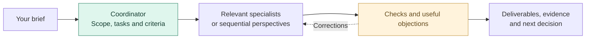

<p align="center">
  
</p>

<p align="center">
  <strong>Turn a project brief into coordinated AI work.</strong><br>
  Research an idea, prepare a launch, build a product or improve your business.
</p>

<p align="center">
  <a href="README.fr.md">Français</a> ·
  <a href="#installation">Install</a> ·
  <a href="#your-first-mission">Start</a> ·
  <a href="evals/README.md">Evaluation results</a> ·
  <a href="#documentation">Guides</a>
</p>

## What is Orka?

**Orka is an Agent Skill that teaches your assistant to coordinate business specialists around one mission.** You describe the result you need. A coordinator selects relevant roles, organizes their work and reviews, and delivers findings, evidence and open questions.

The skill is a folder of instructions, references and optional tools. Your assistant supplies the models, file access, browsing and any subagents. With authorized subagents, Orka delegates to separate specialists; otherwise, it applies their perspectives sequentially and says so.

**28 roles · 8 teams · 9 workflows.** Use only the roles the mission needs.

## What can you do with it?

| Mission | Result to ask for |
|---|---|
| Explore an idea | A sourced decision brief, uncertainties and the next validation test |
| Prepare a launch | Positioning, a marketing plan and draft content |
| Build a product | Implementation in your repository, tests and review findings |
| Improve the business | Prioritized actions from customer feedback, operations or agent usage |

## How a mission works



A small task stays compact. Agreement between agents is not proof of market demand; unresolved criteria remain visible.

## Installation

**You can install and use Orka without Python.**

1. Download [orka.zip](https://github.com/AjinthAT/orka-skill/releases/latest/download/orka.zip) and extract it. Use the skill ZIP, not the repository source archive.
2. Copy the complete `orka` folder, including its references and guides, to your assistant's skills directory:

   | Assistant | Default user directory | Invocation |
   |---|---|---|
   | Codex | `~/.agents/skills/orka/` | `$orka` |
   | Claude Code | `~/.claude/skills/orka/` | `/orka` |
   | Hermes, default profile | `~/.hermes/skills/orka/` | `/orka` |

3. Start a new session if needed, select Orka and give it a mission.

Use your host's configured directory if it differs. Back up an existing installation before replacing it. For **Claude web/desktop**, import the ZIP through the custom Skills interface instead; availability depends on your account and organization settings.

[Detailed installation guide →](docs/INSTALLATION.md) — optional Python installer, project installations, other hosts, updates and removal.

## Your first mission

Invoke **`$orka` in Codex** or **`/orka` in Claude Code or Hermes**, then give it a concrete brief. For example:

```text
Study an appointment-booking product for independent fitness coaches in France.
Assess competitors, customer needs, technical feasibility and pricing assumptions.
Use specialist subagents if available and permitted. Save a decision brief with
sources, uncertainties and the next validation test. Respond in English.
```

Provide your project, desired result, relevant files and known constraints. You can go directly to marketing, development or support when that is the work you need.

The [getting-started guide](.agents/skills/orka/GUIDE.md) includes more prompts and is included in every skill ZIP. Orka ends responses with one **“Next prompt to copy”**, unless you request otherwise or require an exclusive format. The suggestion does not execute itself.

When a decisive input is missing, Orka requests a targeted context supplement, keeps its source and version, and states how it changes the result. The [document-based protocol](.agents/skills/orka/references/prompting-agents.md#compléter-le-contexte-par-passes-bornées) allows three requests per task by default, carried across retries. A blocked task returns useful partial work and explicit unknowns. This needs no Python.

## When do you need Python?

| Use | Requirement |
|---|---|
| Manual installation and ordinary skill use | No Python requirement from Orka |
| Supplied installer or local helpers | Python 3.10+, standard library only |
| Repository maintenance checks | Python and development dependencies |

Start with mission documents. The optional preparer makes requests repeatable; the supervision register tracks reservations, attempts and input versions across interruptions; the agent report summarizes supplied measurements. Use them when those checks help your mission.

Repeated-evaluation preparation and reporting are available as an optional [repository maintenance tool](docs/EVALUATIONS.md), outside the skill ZIP. It freezes inputs and reads supplied observations; it never launches models. The document-based procedure remains usable without Python.

The optional [installation diagnostic](.agents/skills/orka/references/diagnostic-installation.md) checks an explicit skill folder in read-only mode, with an optional reference comparison. A manual check without Python is documented too; file presence never proves host activation.

These helpers do not launch models, collect token telemetry or enforce financial budgets. Model usage depends on your assistant's plan and costs. Your own project's runtime is a separate choice.

## Compatibility and limits

- Orka follows the [Agent Skills format](https://agentskills.io/specification). The host determines model settings, tools and delegation; complete missions have not been evaluated on every host.
- Detailed instructions are currently in French. Guides are available in English and French; deliverables follow the requested language.
- The supplied model catalogue and request preparer target Codex parameters. On another host, use native settings and document-based tracking unless a compatible catalogue is configured.
- Orka works during authorized sessions. Installation does not create a permanent service. External communications, spending, publication and deployment require authorization covering the action.

## Evaluation results

| Evaluation | Scope and limits |
|---|---|
| [First comparative pilot](evals/pilote-2026-10-22/README.md) | Orka 0.4.0, three cases and three conditions, one run per cell. Nine outputs met the reviewed criteria; one out-of-scope skill read limits comparability. |
| [README discovery](evals/decouverte-2026-10-22/README.md) | One fresh-context discovery route; host activation and complete missions were not tested. |
| [L2 acceptance](evals/contexte-L2-2026-10-22/README.md) | Three synthetic tasks checking targeted context, version changes and stopping conditions; no reference-model comparison or independent access audit. |

**No quality or cost advantage is established.** Tokens and costs were unavailable. The [evaluation index](evals/README.md) links to preserved outputs, prompts, hashes and methodological limits.

## Documentation

| Start here | Explore further |
|---|---|
| [Getting started](.agents/skills/orka/GUIDE.md) · [Français](.agents/skills/orka/GUIDE.fr.md) | First missions, prompts and resuming work |
| [Installation](docs/INSTALLATION.md) | Manual installation, optional installer and host details |
| [Teams and roles](.agents/skills/orka/references/roles.md) | Strategy, marketing, sales, product, engineering, finance, AI resources and customer relations |
| [Business workflows](.agents/skills/orka/references/workflows-entreprise.md) | Studies, delivery, launch and department handoffs |
| [Skill entry point](.agents/skills/orka/SKILL.md) | Coordination rules and references for vision, innovation, experiments, naming and agent resources |
| [Implementation](docs/IMPLEMENTATION.md) | Local supervision, available capabilities and future work; in French |
| [Evaluations](evals/README.md) | Preserved cases, results and methodological limits |

## Development and contributions

[ECC-01 progress](docs/LOT-ECC-01.md) — L1 installation diagnostics delivered in 0.5.0; L2 document-based progressive context added in 0.6.0; L3 preparation/reporting tooling delivered in 0.7.0 and tested on fabricated observations. Comparative qualification (L4) remains planned. Specification and acceptance checks are in French.

See [CONTRIBUTING.md](CONTRIBUTING.md) for repository layout, verification commands, ZIP builds and preservation of evaluation records. Describe the observed problem and relevant checks in issues or pull requests. Keep private mission data in its designated workspace, outside public contributions.

[MIT license](LICENSE), included in the skill ZIP and installations.
