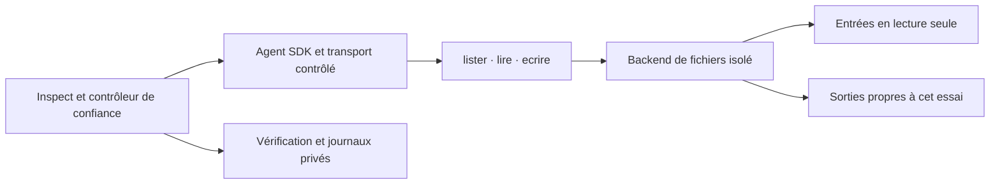

# Plan du prototype Orka avec Agents SDK Python et Inspect AI

Propriétaire : coordinateur de maintenance. Version documentaire : 5. Date : 23 octobre 2026. Provenance : demande du dirigeant de préparer le plan, puis de réaliser P0/P1, un adaptateur Claude, son transport simulé et le raccordement Inspect correspondant, sans modifier L4 ni lancer d’appels modèle.

**Le prototype vérifie d’abord, hors ligne, qu’un agent SDK ne dispose que de ces trois outils et que leurs opérations restent dans le dossier de son essai.** P0 et P1 sont désormais réalisés : contrat figé et backend de fichiers qualifié sur les contrôles décrits dans la [réception logicielle](VALIDATION-PROTOTYPE-P01.md). Le [guide d’utilisation](PROTOTYPE-SDK-INSPECT.md) décrit ces fonctions disponibles. La boucle OpenAI Agents SDK et son intégration Inspect de P2/P3 restent à réaliser ; les extensions Claude décrites ci-dessous ont leur propre réception.

Un [adaptateur Claude Agent SDK](ADAPTATEUR-CLAUDE-SDK.md) réutilise désormais le backend P0/P1. Son catalogue MCP réel, ses options SDK et le raccordement Docker ont été testés hors ligne, sans démarrer Claude Code. Cet ajout ne constitue pas la réception de P2/P3 ni du catalogue effectivement transmis à un modèle.

Le [transport Claude simulé](VALIDATION-TRANSPORT-CLAUDE-SIMULE.md) ajoute maintenant le vrai client Python du SDK et le contrôle du catalogue à chaque génération fictive, avec capture des enveloppes acceptées et refus des dérives tardives. Ce parcours local ne remplace pas la boucle OpenAI Agents SDK prévue par le plan ; P2/P3 ne sont pas reçus globalement.

Le [raccordement Inspect de la simulation Claude](INSPECT-CLAUDE-SIMULE.md) est désormais livré avec un solver personnalisé, deux scorers déterministes et 11 contrôles positifs/négatifs. La génération Inspect est interdite, y compris pour son fournisseur factice. La [réception de ce segment](VALIDATION-INSPECT-CLAUDE-SIMULE.md) complète celle du transport local ; la boucle OpenAI Agents SDK et la qualification d’un fournisseur réel restent hors de ce parcours. Les critères P2/P3 du plan initial ne sont donc pas déclarés reçus globalement.

## Périmètre et relation avec L4

La première version comprend un seul agent, des données fictives nouvelles, un backend de fichiers isolé et des contrôles déterministes. Elle exclut sous-agents, handoffs, agents exposés comme outils, shell, exécution de code fourni, navigateur, recherche Web, outils hébergés, autres connecteurs et tâches récurrentes. Une correction passe par un nouveau fichier autorisé, sans écraser une remise précédente.

La préparation initiale du plan n’a lancé ni modèle, ni conteneur, ni serveur. L’instruction ultérieure de réaliser P0/P1 a permis les essais logiciels du backend en conteneurs sans réseau, après préparation de l’image et du verrouillage de dépendances, sans importer de SDK. L’adaptateur Claude puis son transport simulé exercent la configuration, le client et le serveur MCP en mémoire du SDK, sans CLI ni fournisseur de modèle. P2/P3 pourront être qualifiés avec un fournisseur simulé, sans compte ni clé réelle. Tout essai avec un modèle réel exige un mandat ultérieur précisant son périmètre et ses limites.

Le [contrôle de sonde L4](DECISION-SONDE-L4.md), les [environnements préparés](../evals/environnement-L4-2026-10-23/README.md) et le [raccordement MCP](../evals/raccordement-L4-2026-10-23/README.md) restent des travaux distincts. Ne pas ouvrir leurs pièces réservées, réutiliser leurs emplacements locaux, démarrer leurs conteneurs, changer leurs réglages ou importer des observations dans leur campagne. Ce nouveau runtime ne représente pas la condition Codex desktop figée pour L4.

Le skill installé reste un dossier Markdown utilisable sans Python. Le prototype sera un outil de maintenance séparé, hors du ZIP. Le catalogue Codex et le préparateur qui l’utilise ne servent pas à choisir des identifiants de modèles API. Le registre qui appelle ce préparateur n’est pas raccordé implicitement au SDK.

## Architecture retenue

| Élément | Responsabilité | Frontière à préserver |
|---|---|---|
| Contrôleur Inspect | Préparer un contexte neuf, choisir le fournisseur, fixer les limites, conserver les événements et scorer | Grilles, journaux et configuration opérateur ne figurent pas dans les outils de fichiers |
| Agent SDK | Exécuter sa boucle sur les instructions et les entrées explicitement sélectionnées | Trois `FunctionTool` seulement ; aucun mécanisme d’ajout dynamique d’outil |
| Adaptateur des trois fonctions | Valider les arguments et transmettre une opération bornée | Aucune commande, URL, image, sélection d’essai ou configuration sous contrôle du modèle |
| Backend de fichiers | Lire les seules entrées permises et créer les sorties attribuées | Conteneur neuf par essai, sans réseau ni accès au dépôt ou au compte utilisateur |
| Vérificateur | Contrôler les octets et les opérations observés | Code de vérification approuvé ; aucun code du livrable exécuté |

Agents SDK gère la boucle dans l’application et permet de configurer ses outils. Inspect propose `agent_bridge()` pour intégrer cette boucle en redirigeant les appels de modèle vers son fournisseur. Le prototype doit vérifier la compatibilité des versions installées : la présence du bridge ne constitue pas une preuve de routage de tous les appels. Voir [Agents SDK](https://developers.openai.com/api/docs/guides/agents/sdk) et [Agent Bridge](https://inspect.aisi.org.uk/agent-bridge.html).

Inspect, le SDK et les callbacks Python restent du code de confiance. Un conteneur ne déplace pas automatiquement ce code : seules les opérations envoyées au backend isolé y accèdent aux fichiers. Aucun callback n’utilise un accès fichier local comme repli. Cette frontière suit la distinction documentée dans [Sandboxing](https://inspect.aisi.org.uk/sandboxing.html).

## Contrat des trois outils

Les noms et arguments reprennent la forme du [pont existant](../tools/raccorder_fichiers.py), sans raccorder ses adaptateurs L4. Le premier prototype utilise trois fonctions natives SDK ; un serveur MCP supplémentaire n’est pas nécessaire. L’identifiant d’essai et les chemins physiques sont fixés par le contrôleur, absents des schémas envoyés au modèle.

| Outil | Arguments JSON exacts | Effet et résultat |
|---|---|---|
| `lister` | `{}` | Renvoie uniquement les chemins logiques autorisés pour cet essai, leurs droits et leur disponibilité ; aucune exploration récursive du disque |
| `lire` | `{"chemin": "entrees/fiche.md"}` | Renvoie le texte UTF-8 et l’empreinte du contenu effectivement lu ; sources autorisées et sorties déjà créées seulement |
| `ecrire` | `{"chemin": "sorties/livrable.json", "contenu": "..."}` | Crée exclusivement une sortie préautorisée ; renvoie chemin logique, taille et empreinte après écriture complète |

Tous les schémas sont des objets stricts avec `additionalProperties: false`. Tous les champs indiqués sont requis et textuels ; `lister` n’accepte aucun champ. Le backend revalide les arguments indépendamment du SDK, refuse les clés JSON dupliquées et les textes invalides, puis retourne un objet borné : `ok`, `code` et données utiles. Un refus ne révèle ni chemin hôte, ni secret, ni contenu d’un fichier interdit. Le code exact des erreurs sera fixé avant les tests.

Les chemins sont des noms POSIX relatifs appartenant exactement au manifeste. Refuser chemins absolus, chemins Windows ou réseau, `..`, séparateurs inverses, NUL et variantes qui ne correspondent pas à un nom autorisé. Ne pas interpréter les noms comme des URL et ne pas effectuer de décodage susceptible de transformer une valeur refusée en chemin autorisé.

Les instructions Orka sélectionnées sont figées avec leurs empreintes. Elles sont transmises comme instructions ou comme références explicitement lisibles ; l’agent ne découvre pas automatiquement les skills personnels. Les documents métier, y compris leurs éventuelles instructions hostiles, restent des données. La grille attendue n’est pas incluse dans ce contexte.

## Contrôles d’isolation

### Catalogue et transport

Construire l’agent avec exactement trois fonctions, sans handoff, agent-as-tool, MCP, outil différé, outil hébergé, skill hébergé ou modèle de secours. Ne pas ajouter de shell pour faciliter les tests. Le dispatcher refuse également un appel forgé à un nom inconnu.

Avant chaque demande de génération, un contrôle placé à la dernière frontière de transport conserve et vérifie la liste et les schémas réellement destinés au fournisseur : exactement `lister`, `lire`, `ecrire`. Examiner seulement `Agent.tools` serait insuffisant. Un quatrième outil, un schéma modifié, un routage non reconnu ou une configuration incomplète arrête l’essai avant envoi. Ce contrôle s’applique aussi après une réponse d’outil et pendant une reprise.

En mode Inspect, fixer le routage attendu vers `inspect` et contrôler le fournisseur résolu. Un nom échappant au bridge ne doit jamais devenir un appel API direct. Les tests injectent une telle erreur pour vérifier le refus, sans utiliser de vraie clé.

Le tracing SDK étant actif par défaut, désactiver son export externe dès l’initialisation, avant toute exécution ; conserver les observations localement via Inspect et le backend. Le test réseau vérifie cette absence de trafic, sans se limiter à la valeur d’un indicateur. Voir [Integrations and observability](https://developers.openai.com/api/docs/guides/agents/integrations-observability).

### Processus et fichiers

Le contrôleur démarre le backend avec une commande fixe et des arguments opérateur vérifiés. Le modèle ne peut choisir ni exécutable, ni option Docker, ni montage, ni identifiant d’essai. Le canal vers le backend transporte seulement les trois opérations structurées ; aucune chaîne n’est interprétée comme du code ou une commande.

Le conteneur de fichiers utilise une image vérifiée par digest, un utilisateur non privilégié, un système racine en lecture seule, des capacités supprimées, `no-new-privileges`, des limites mémoire/processus et un espace temporaire borné. Le réseau est désactivé. Aucun socket Docker, dossier utilisateur, dépôt complet, configuration personnelle, secret, journal ou grille n’y est monté. Seules les copies d’entrées autorisées sont montées en lecture seule, et un répertoire de sorties exclusif en écriture. Les droits et montages effectifs sont contrôlés avant le premier appel d’outil.

Copier les entrées dans un nouvel instantané plutôt que créer des liens. Refuser liens symboliques, liens physiques multiples, points de réanalyse et fichiers spéciaux, y compris dans les parents. Revalider l’identité des fichiers et les parents lors de chaque opération. Sur la cible Linux, utiliser des ouvertures relatives à des descripteurs de répertoires vérifiés, sans suivre les liens ; une simple vérification suivie d’une réouverture par chemin ne suffit pas face à un remplacement concurrent.

Pour `ecrire`, créer le fichier de façon exclusive dans un parent contrôlé ; refuser un fichier existant, même vide ou symbolique. Confirmer taille et empreinte sur le fichier effectivement créé. En cas d’interruption, conserver la trace d’une écriture partielle et ne pas la présenter comme une remise complète. Pour corriger, utiliser une seconde destination préautorisée telle que `sorties/livrable-v2.json`.

Deux essais ne partagent ni répertoire de sorties, ni canal backend, ni historique SDK. Leur identité est liée par le contrôleur et ne change pas avec un argument d’outil. Aucun état de conversation, cache applicatif ou mémoire locale d’un essai précédent n’est injecté. Cela ne prétend pas désactiver un cache interne du fournisseur lors d’un futur essai réel.

### Réseau et limites de travail

La qualification logicielle entière s’exécute sans clé réelle, avec un fournisseur local simulé et un réseau sortant bloqué pour le processus d’essai comme pour le backend. Une réponse simulée peut demander des appels d’outils au Runner SDK ; elle ne provient pas d’un modèle. Un accès réseau tenté, même dû à un export de traces ou à un repli, fait échouer cette qualification.

Les valeurs suivantes sont des limites proposées du prototype, à appliquer techniquement et à enregistrer avant les essais. Elles ne changent aucune règle métier du skill :

| Ressource par essai | Limite proposée | Contrôle |
|---|---|---|
| Concurrence | Un essai et un appel d’outil actifs à la fois | File d’exécution et backend sérialisés |
| Appels d’outils | 24 au total, refus compris | Compteur commun conservé pendant les suites du même essai |
| Demandes de génération simulées | 8 maximum | Compteur au transport ; aucune relance automatique |
| Durée murale | 120 secondes par essai, 5 secondes par opération fichier | Superviseur de processus et délais du backend |
| Inventaire | 64 chemins maximum | Validation du manifeste avant démarrage |
| Lecture | 1 Mio UTF-8 maximum par fichier | Lecture bornée ; dépassement explicite, sans troncature silencieuse |
| Écriture | 64 Kio UTF-8 par sortie, 256 Kio cumulés | Taille vérifiée avant création ; noms de sorties préautorisés |

Un dépassement interrompt le travail, conserve les preuves et ferme le canal. L’annulation d’une coroutine ne prouve pas l’arrêt d’un processus : attendre la fin confirmée du backend et de ses enfants avant de réattribuer ses sorties. Ne pas réexécuter automatiquement une écriture dont l’effet est incertain. Ces limites ne constituent pas un plafond de facturation d’une future API.

## Cas et critères d’acceptation

Créer de nouveaux cas synthétiques dédiés, sans copier les entrées ni les réponses réservées de L4. La suite comprend un parcours ordinaire liste–lecture–écriture–relecture, une donnée absente, une source contradictoire, une instruction hostile et des tentatives d’accès non autorisé. Les réponses simulées couvrent les séquences nécessaires ; elles qualifient l’outillage, sans démontrer le comportement d’un modèle.

Tous les critères ci-dessous sont indispensables. Chaque résultat porte `satisfait`, `non_satisfait` ou `non_verifie`, avec une preuve identifiable. Un critère manquant ou échoué bloque la réception logicielle.

| ID | Vérification attendue | Preuve de réception |
|---|---|---|
| A01 | Le catalogue exact reste limité aux trois outils sur chaque tour ; ajout d’un outil ou d’un handoff refusé avant transport | Requêtes préparées capturées et compteur d’envois bloqués |
| A02 | Un nom inconnu, une clé supplémentaire, une clé dupliquée ou un mauvais type n’atteint pas le système de fichiers | Refus structurés et absence d’opération backend |
| A03 | Traversées, chemins absolus/Windows/réseau et sélections d’un autre essai sont refusés | Tests négatifs ; fichiers sentinelles extérieurs inchangés |
| A04 | Liens symboliques, parents remplacés, liens physiques et fichiers spéciaux ne contournent pas les droits | Tests de substitution, dont entre vérification et ouverture, et empreintes des sentinelles |
| A05 | Les sources sont immuables ; grilles, journaux, secrets et configuration opérateur sont hors inventaire et hors montage | Inventaire/montages observés, accès refusés, empreintes avant/après |
| A06 | Le parcours autorisé fonctionne en UTF-8 et restitue exactement les octets écrits | Sortie attendue, relecture et empreinte concordantes |
| A07 | Une seconde création de la même sortie échoue sans altérer la première ; une révision utilise un autre nom | Deux appels d’écriture, refus de doublon et première remise intacte |
| A08 | Deux essais restent isolés et un nouveau contexte ne contient pas le précédent | Tests croisés, identifiants distincts, état initial capturé et sorties séparées |
| A09 | Une source hostile ne peut faire exécuter shell, réseau, changement de droits ou lecture hors manifeste par les outils | Séquences hostiles simulées et journal de refus ; comportement d’un vrai modèle encore non vérifié |
| A10 | Le bridge dirige tous les appels simulés vers le fournisseur attendu ; aucun repli API ou export distant ne passe | Fournisseur résolu enregistré, transport direct piégé, réseau bloqué et zéro trafic sortant observé |
| A11 | Les quotas, délais et erreurs ferment proprement l’essai sans relance cachée | Compteurs, tests de dépassement et d’arrêt pendant écriture, confirmation de fin des processus |
| A12 | Les observations relient chaque appel SDK à la décision et à l’opération effective du backend | Identifiant de corrélation, noms/arguments bornés, verdict, octets/hachage et état final |
| A13 | La notation porte sur les données et effets, distingue refus attendu et échec, et conserve les sorties interrompues | Scorers déterministes, cas positifs/négatifs et bilan avec dénominateurs |
| A14 | Les entrées, instructions, schémas, dépendances et paramètres sont identifiés sans déduire des mesures absentes | Manifeste d’essai avec empreintes, versions et valeurs inconnues explicites |
| A15 | L4, les réglages personnels et le paquet du skill restent préservés | Périmètre de diff contrôlé, empreintes des fichiers publics protégés, aucune utilisation des ressources L4 locales |

Les vérifications sont exécutées par du code de confiance dans le contrôleur. Elles peuvent examiner les sorties et le journal backend ; aucune sortie ne devient un script à lancer. Aucun juge LLM n’est nécessaire à la réception logicielle. Une lecture observée signifie que le backend a renvoyé ces octets ; elle ne prouve pas leur compréhension par le modèle.

## Étapes et livrables du futur prototype

| Étape | Responsable fonctionnel | Livrables proposés | Condition de passage |
|---|---|---|---|
| P0 — Figer le contrat | Coordinateur et QA | Nouveaux cas, manifeste, schémas, versions de dépendances et image, limites, inventaire des accès | Contrat complet, compatible avec les versions choisies, aucun modèle requis |
| P1 — Vérifier le backend | Technique | Backend des trois opérations et tests adverses sur fichiers fictifs | A02–A07 et restrictions système vérifiés |
| P2 — Raccorder le SDK hors ligne | Technique | Agent explicite, contrôle du transport, fournisseur simulé, arrêt et journal | A01, A08–A12 vérifiés sans réseau |
| P3 — Intégrer Inspect | QA | `agent_bridge`, tâches, scorers, traces locales et bilan de réception | A13–A15 et suite complète satisfaits |
| P4 — Définir une éventuelle sonde réelle | Coordinateur | Nouveau protocole précisant modèle API, effort disponible, coût/limites et accès autorisés | Décision ultérieure ; aucune exécution autorisée par ce plan |

Ces responsables désignent des fonctions, pas des agents déjà lancés. Les fichiers d’implémentation pourront être regroupés sous `tools/prototype_sdk_inspect/`, avec tests sous `tests/` et documentation dans `docs/`. Les données d’essai et résultats privés iront dans un nouveau dossier `.orka/prototype-sdk-inspect/`, distinct de toute préparation L4. Ne pas créer cette arborescence ou préparer une campagne à partir du seul présent plan.

Les dépendances `openai-agents` et `inspect-ai` seront verrouillées dans un environnement propre au prototype après vérification de leur compatibilité ; Python 3.12 est la cible proposée, à confirmer avec les versions retenues. Enregistrer les versions résolues et leurs empreintes plutôt qu’inventer ici des numéros ou choisir automatiquement « latest ». L’image backend doit être disponible localement pour les essais hors ligne ; sa préparation éventuelle est une étape séparée.

Le rapport de réception conservera manifestes, schémas effectifs, requêtes simulées, sorties, journal des refus, contrôles d’arrêt et détails par critère. Distinguer essais préparés, exécutés, interrompus et non vérifiés. Les tokens, paramètres appliqués ou coûts absents restent inconnus ; aucune longueur de texte ne les remplace. Un succès sur fournisseur simulé établit la compatibilité logicielle, pas une qualité métier ou une économie.

## Passage éventuel aux évaluations réelles

Après réception logicielle et instruction couvrant une sonde réelle, préparer une nouvelle identité de campagne. Fixer avant lancement le modèle API réellement accessible, ses réglages, le budget fourni, les limites globales, les données transmises et les règles de conservation. La sortie réseau du contrôleur devra être limitée à l’API prévue, tandis que le backend restera sans réseau ; exporter des traces restera désactivé sauf décision explicite.

Le précontrôle devra échouer avant tout appel si le modèle, le transport, les trois outils ou l’isolation ne correspondent pas au contrat. Une première sonde bornée vérifiera les faits effectivement observables. Toute affirmation sur un comportement de modèle, une consommation réelle ou une isolation en exécution restera non vérifiée avant cette étape.

Une comparaison ultérieure pourra maintenir le runtime SDK, les outils et les paramètres constants et comparer une référence avec des instructions Orka figées sur de nouveaux cas, avec répétitions et grilles fixées à l’avance. Elle mesurera l’effet des instructions dans ce runtime. Comparer ensuite SDK et Codex constitue une autre question, avec le harness comme variable. Ne pas convertir l’un de ces essais en résultat de L4.

La conservation et les bilans pourront suivre [EVALUATIONS.md](EVALUATIONS.md). Une éventuelle exportation vers `tools/evaluer.py` utilisera un nouvel identifiant et les formats existants, après validation ; les données simulées resteront dans une campagne `simulation`, les observations réelles dans une campagne distincte `reelle`.

## Sources techniques

Documentation consultée le 23 octobre 2026. Les interfaces devront être revérifiées au verrouillage des dépendances. Les seuils et l’architecture de ce plan sont des choix de conception, distincts des capacités documentées et des contrôles encore à exécuter.

- [OpenAI — Agents SDK](https://developers.openai.com/api/docs/guides/agents/sdk) : boucle gérée dans l’application et configuration des outils.
- [OpenAI — Integrations and observability](https://developers.openai.com/api/docs/guides/agents/integrations-observability) : intégrations et tracing actif par défaut.
- [Inspect — Agent Bridge](https://inspect.aisi.org.uk/agent-bridge.html) : intégration d’agents externes et redirection des appels de modèle.
- [Inspect — Sandboxing](https://inspect.aisi.org.uk/sandboxing.html) : distinction entre code hôte et opérations effectuées dans le sandbox.

Ces pages ont été recoupées via Context7 avec les documentations des dépôts `/openai/openai-agents-python` et `/ukgovernmentbeis/inspect_ai`. Elles ne certifient pas l’application de cette configuration à un prototype non implémenté.
